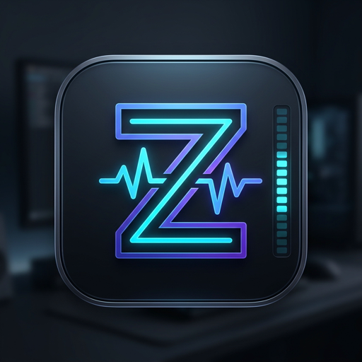

#  ZenithBar

A modern, lightweight hardware diagnostics and telemetry sidebar for Windows and Linux, built in Rust.

ZenithBar is inspired by [Sidebar Diagnostics](https://github.com/ArcadeRenegade/SidebarDiagnostics), reimagined with a modern Fluent Acrylic design, multi-monitor AppBar docking, and native system integration.

---

### Features

- **Hardware Telemetry:** Real-time monitoring for CPU, RAM, GPU, storage drives, and network throughput.
- **Desktop AppBar Docking:** Docks seamlessly to the left or right edge of your screen, reserving the desktop work area so maximized windows do not overlap.
- **Fluent Acrylic Aesthetic:** Modern translucent glass styling with subtle animations and dark mode theme.
- **Multi-Monitor & DPI Aware:** Dynamically select monitors with crisp scaling on any display resolution.
- **Customizable UI:** Toggle individual hardware cards, adjust sidebar width (240px, 300px, 360px), background opacity, and text alignment.
- **System Tray & Hotkeys:** Control visibility instantly via the system tray menu or with global hotkey `Ctrl+Shift+S`.

---

### Prerequisites

- **Windows:** Windows 10 (version 1809 or higher) or Windows 11 (64-bit).
- **Linux:** x86_64 desktop environment (X11 or Wayland).
- Zero external runtime dependencies: standalone executable with no .NET or Visual C++ runtime required.

---

### Configuration

ZenithBar can be configured directly from the graphical **Settings** window (accessible via the tray icon menu or the gear button at the top).

Settings are stored in JSON format:
- **Portable Mode:** If a `Settings.json` file is present in the same folder as `ZenithBar.exe`, settings are read and saved locally.
- **Standard Mode:** Otherwise, settings are automatically stored in `%LOCALAPPDATA%\ZenithBar\Settings.json`.

#### Default Hotkeys
- `Ctrl + Shift + S`: Toggle sidebar visibility
- `Ctrl + Shift + E`: Cycle dock edge (Left / Right)
- `Ctrl + Shift + M`: Cycle target monitor
- `Ctrl + Shift + R`: Toggle workspace reservation (AppBar)

---

### License

Distributed under the MIT License. See [LICENSE](LICENSE) for details.
